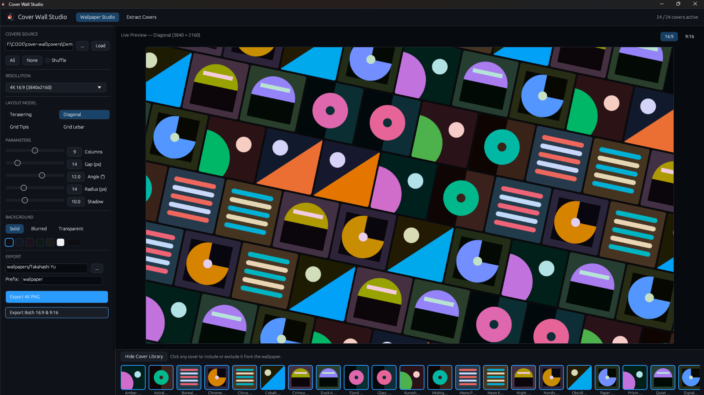

<div align="center">


# Cover Wall Studio

**Aplikasi studio desktop 100% pure Rust untuk mengekstrak cover album dari koleksi FLAC dan menyusunnya menjadi wallpaper 4K (`16:9` & `9:16`).**

[English](README.md) | **Bahasa Indonesia** | [简体中文](README.zh.md)


</div>

---

## Ringkasan

**Cover Wall Studio** menggantikan alur skrip eksternal dengan aplikasi desktop native berakselerasi GPU. Aplikasi ini membaca metadata FLAC dan gambar *embedded* secara langsung melalui `lofty`, merender wallpaper 4K secara paralel di seluruh core CPU menggunakan `rayon` dan `fast_image_resize`, serta dirancang dengan antarmuka studio gelap berbasis sistem warna **OKLCH**.

<div align="center">



</div>

---

## Fitur Utama

- **Ekstraktor Cover FLAC Pure Rust**
  - Memindai folder `.flac` secara rekursif menggunakan `lofty` tanpa memerlukan `ffmpeg` atau `ffprobe` eksternal.
  - Menghindari duplikasi berdasarkan tag `ALBUM` (dengan fallback folder induk `CD n` / `Disc n`) serta fallback file gambar `cover.*`, `folder.*`, atau `front.*`.
  - Berjalan di background dengan *progress bar* real-time, tombol batal, dan status sumber (`EMBEDDED`, `FOLDER`, `MISSING`).
- **Wallpaper Studio 4K Interaktif**
  - **4 Model Layout**: `Terasering` (bata bergeser), `Diagonal` (mosaik miring dengan sudut kustom), `Grid Tipis` (grid celah tipis), dan `Grid Lebar` (grid celah lebar dengan sudut membulat).
  - **Live Preview Tajam**: Preview beresolusi hingga `1920px` dengan tombol cepat `16:9` / `9:16`, slider `Columns`, `Gap`, `Angle`, `Radius`, `Shadow`, serta `Shuffle` dengan `Seed`.
  - **Mode Background & Palet OKLCH**: Mendukung `Solid` (swatch OKLCH + *color picker*), `Blurred` (mosaik blur dari cover dengan atur *tint opacity*), dan `Transparent` (ekspor PNG transparan).
  - **Strip Galeri Cover**: Klik thumbnail untuk memilih/mengecualikan cover tertentu, lengkap dengan dukungan font CJK Windows untuk judul album Jepang, Mandarin, dan Korea.
  - **Ekspor Aman Anti-Timpa**: Mendukung ekspor `3840×2160` (`16:9`), `2160×3840` (`9:16`), atau keduanya sekaligus dengan penamaan versi otomatis (`_v2`, `_v3`, …).

---

## Cara Menjalankan

### Prasyarat
- [Rust](https://www.rust-lang.org/tools/install) `1.85+` (Edition 2024)

### Build & Jalankan
```powershell
git clone https://github.com/SayMaven/cover-wall.git
cd cover-wall
cargo run --release
```

### Pengujian & Lint
```powershell
cargo test
cargo clippy --all-targets -- -D warnings
```

---

## Struktur Proyek

```text
cover-wall/
├── assets/
│   └── logo.svg              # Ikon vektor aplikasi (palet OKLCH)
├── src/
│   ├── main.rs               # Entry point & rasterizer ikon SVG
│   ├── theme.rs              # Konverter OKLCH -> sRGB, token tema & fallback font CJK
│   ├── extractor.rs          # Ekstraktor metadata & artwork FLAC pure Rust
│   ├── renderer.rs           # Engine komposisi wallpaper 4K paralel
│   └── ui/
│       ├── mod.rs            # State aplikasi & worker background
│       ├── studio_view.rs    # Live preview, panel kontrol & strip cover
│       └── extractor_view.rs # Workspace pemindai FLAC
├── extract_covers.py         # Skrip CLI Python awal (tetap dipertahankan)
├── make_wallpaper.py         # Skrip CLI Python awal (tetap dipertahankan)
└── Cargo.toml
```

---

## Lisensi

Dilisensikan di bawah salah satu dari:
- [MIT License](LICENSE-MIT)
- [Apache License, Version 2.0](LICENSE-APACHE)

sesuai pilihan Anda.
