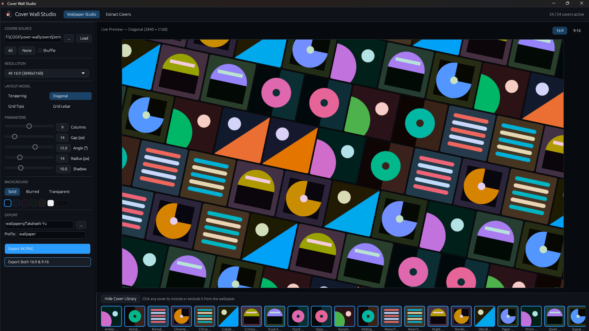

<div align="center">


# Cover Wall Studio

**A 100% pure Rust desktop studio for extracting album artwork from FLAC collections and composing 4K (`16:9` & `9:16`) mosaic wallpapers.**

**English** | [Bahasa Indonesia](README.id.md) | [简体中文](README.zh.md)


</div>

---

## Overview

**Cover Wall Studio** replaces slow external-process scripts with a native, GPU-accelerated Rust application. It reads FLAC metadata and embedded artwork directly via `lofty`, composites 4K wallpapers in parallel across all CPU cores with `rayon` and `fast_image_resize`, and presents everything inside a distraction-free dark studio UI built on a perceptually uniform **OKLCH** color system.

<div align="center">



</div>

---

## Key Features

- **Pure Rust FLAC Cover Extractor**
  - Recursively scans `.flac` libraries using `lofty` without requiring external `ffmpeg` or `ffprobe` binaries.
  - Deduplicates by `ALBUM` tag (with automatic `CD n` / `Disc n` parent-folder fallback) and falls back to `cover.*`, `folder.*`, or `front.*` images.
  - Non-blocking background scan with real-time progress bar, cancellation support, and origin badges (`EMBEDDED`, `FOLDER`, `MISSING`).
- **Interactive 4K Wallpaper Studio**
  - **4 Layout Models**: `Terasering` (brick-staggered), `Diagonal` (tilted mosaic with configurable angle), `Grid Tipis` (thin-gap grid), and `Grid Lebar` (wide-gap rounded grid).
  - **Live HD Preview**: Crisp `1920px`-class live preview with instant `16:9` / `9:16` orientation switching, `Columns`, `Gap`, `Angle`, `Radius`, `Shadow`, and seeded `Shuffle` controls.
  - **Background Modes & OKLCH Palette**: Choose between `Solid` (curated OKLCH swatches + custom color picker), `Blurred` (cover-mosaic blur with adjustable tint opacity), or `Transparent` (alpha-channel PNG export).
  - **Cover Library Strip**: Click thumbnails to include or exclude individual covers, with automatic Windows CJK font fallback for Japanese, Chinese, and Korean album titles.
  - **Safe Non-Overwriting Export**: Exports full `3840×2160` (`16:9`), `2160×3840` (`9:16`), or both at once, automatically versioning filenames (`_v2`, `_v3`, …) so existing wallpapers are never overwritten.

---

## Getting Started

### Prerequisites
- [Rust](https://www.rust-lang.org/tools/install) `1.85+` (Edition 2024)

### Build & Run
```powershell
git clone https://github.com/SayMaven/cover-wall.git
cd cover-wall
cargo run --release
```

### Run Tests & Lints
```powershell
cargo test
cargo clippy --all-targets -- -D warnings
```

---

## Project Structure

```text
cover-wall/
├── assets/
│   └── logo.svg              # Vector application icon (OKLCH palette)
├── src/
│   ├── main.rs               # Entry point & SVG window icon rasterizer
│   ├── theme.rs              # OKLCH -> sRGB converter, theme tokens & CJK font fallback
│   ├── extractor.rs          # Pure Rust FLAC metadata & artwork extractor
│   ├── renderer.rs           # Parallel 4K wallpaper compositing engine
│   └── ui/
│       ├── mod.rs            # Application state & background worker orchestration
│       ├── studio_view.rs    # Live preview, inspector controls & cover strip
│       └── extractor_view.rs # FLAC scanner workspace
├── extract_covers.py         # Legacy Python CLI extractor (preserved)
├── make_wallpaper.py         # Legacy Python CLI renderer (preserved)
└── Cargo.toml
```

---

## License

Licensed under either of:
- [MIT License](LICENSE-MIT)
- [Apache License, Version 2.0](LICENSE-APACHE)

at your option.
