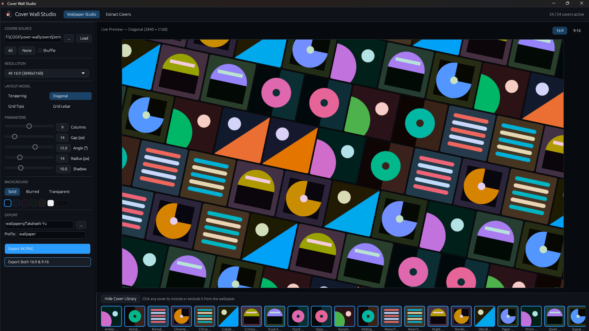

<div align="center">


# Cover Wall Studio

**100% 纯 Rust 开发的桌面端专辑封面提取与 4K（`16:9` / `9:16`）拼接壁纸工作室。**

[English](README.md) | [Bahasa Indonesia](README.id.md) | **简体中文**


</div>

---

## 项目简介

**Cover Wall Studio** 将原有的外部脚本流程升级为原生 GPU 加速的 Rust 桌面应用。它通过 `lofty` 直接读取 FLAC 标签与内嵌封面，借助 `rayon` 和 `fast_image_resize` 多核并行渲染 4K 壁纸，并采用基于感知均匀 **OKLCH** 色彩系统的暗色工作室界面。

<div align="center">



</div>

---

## 核心功能

- **纯 Rust FLAC 封面提取器**
  - 使用 `lofty` 递归扫描 `.flac` 音乐目录，无需依赖外部 `ffmpeg` 或 `ffprobe`。
  - 按 `ALBUM` 标签自动去重（支持 `CD n` / `Disc n` 父目录回退），并自动查找目录内的 `cover.*`、`folder.*`、`front.*` 图片。
  - 后台异步执行，支持实时进度条、取消任务以及来源标记（`EMBEDDED`、`FOLDER`、`MISSING`）。
- **交互式 4K 壁纸工作室**
  - **4 种排版模式**：`Terasering`（错位砖块）、`Diagonal`（可调角度斜向拼接）、`Grid Tipis`（窄间距网格）与 `Grid Lebar`（宽间距圆角网格）。
  - **高清实时预览**：最高 `1920px` 级别实时预览，支持一键切换 `16:9` / `9:16` 比例，以及 `Columns`、`Gap`、`Angle`、`Radius`、`Shadow` 和固定 `Seed` 随机打乱。
  - **背景模式与 OKLCH 调色板**：支持 `Solid`（预设 OKLCH 色板 + 自定义取色器）、`Blurred`（封面模糊背景 + 遮罩透明度调节）及 `Transparent`（透明通道 PNG 导出）。
  - **封面筛选栏**：点击缩略图即可勾选或排除单个封面，内置 Windows 中日韩（CJK）系统字体回退以正常显示非拉丁字符标题。
  - **安全防覆盖导出**：支持导出 `3840×2160`（`16:9`）、`2160×3840`（`9:16`）或同时导出两种尺寸，自动递增文件名版本（`_v2`、`_v3`…），绝不覆盖已有壁纸。

---

## 快速开始

### 环境要求
- [Rust](https://www.rust-lang.org/tools/install) `1.85+`（Edition 2024）

### 编译与运行
```powershell
git clone https://github.com/SayMaven/cover-wall.git
cd cover-wall
cargo run --release
```

### 测试与代码检查
```powershell
cargo test
cargo clippy --all-targets -- -D warnings
```

---

## 目录结构

```text
cover-wall/
├── assets/
│   └── logo.svg              # 矢量应用图标（OKLCH 配色）
├── src/
│   ├── main.rs               # 程序入口与 SVG 窗口图标光栅化
│   ├── theme.rs              # OKLCH -> sRGB 转换、主题色板与 CJK 字体回退
│   ├── extractor.rs          # 纯 Rust FLAC 元数据与封面提取模块
│   ├── renderer.rs           # 并行 4K 壁纸合成引擎
│   └── ui/
│       ├── mod.rs            # 应用状态与后台线程调度
│       ├── studio_view.rs    # 实时预览、参数面板与封面筛选栏
│       └── extractor_view.rs # FLAC 提取工作区
├── extract_covers.py         # 早期 Python CLI 提取脚本（保留）
├── make_wallpaper.py         # 早期 Python CLI 渲染脚本（保留）
└── Cargo.toml
```

---

## 开源协议

本项目采用双协议授权，您可任选其一：
- [MIT License](LICENSE-MIT)
- [Apache License, Version 2.0](LICENSE-APACHE)
